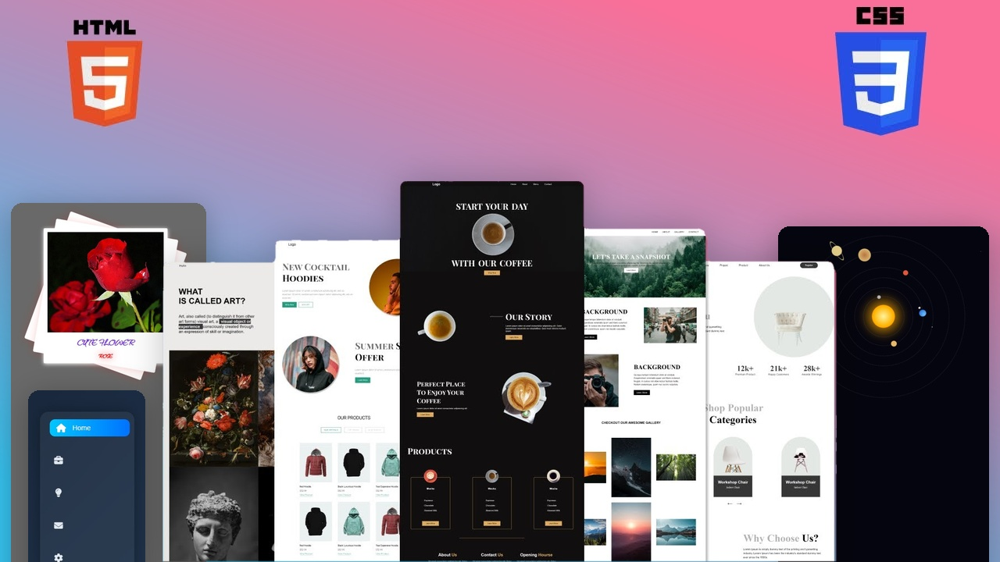

# 🌐 HTML & CSS Projects

Welcome to my HTML & CSS Projects Repository!

This repository contains a collection of web development projects built using **HTML5 and CSS3**. These projects help me improve my frontend development skills, explore creative UI designs, and practice responsive web development.

## 📂 Projects

| No. | Project Name | Description |
|---|---|---|
| 01 | Flower Hovering | Creative flower hover animation |
| 04 | Coffee Landing Page | Coffee shop landing page |
| 05 | The Art | Creative website design |
| 06 | Hoodie Project | Hoodie-themed website design |
| 07 | Chairs Project | Furniture website design |
| 08 | The Barbers | Barber shop website design |

## 🛠️ Technologies Used

- HTML5
- CSS3

## 🎯 Purpose

- Practice HTML and CSS fundamentals.
- Improve frontend development skills.
- Explore modern web design techniques.
- Build creative and interactive user interfaces.

## 👨‍💻 Author

**Dilakshan Uthayakumar**

- GitHub: [@UDilakshan](https://github.com/UDilakshan)
- LinkedIn: [Dilakshan Uthayakumar](https://www.linkedin.com/in/udilakshan/)

---

⭐ If you find these projects interesting, feel free to explore the repository!
